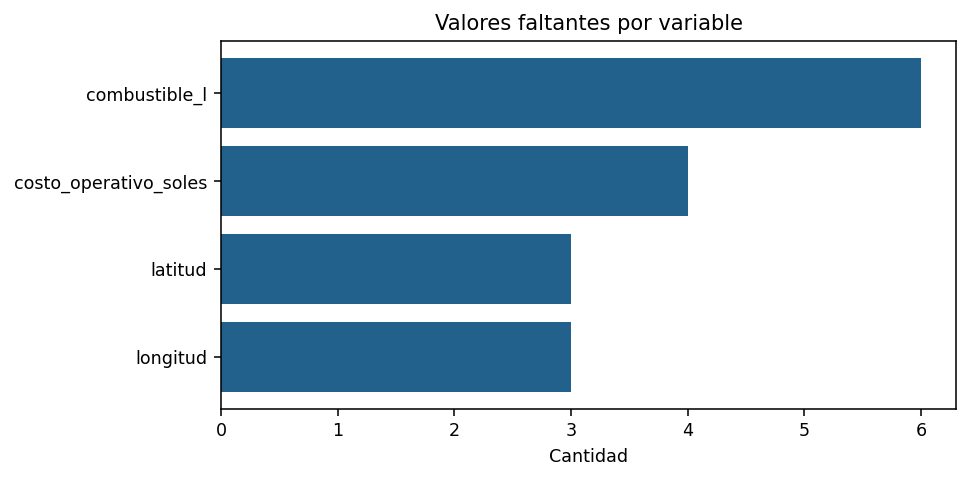
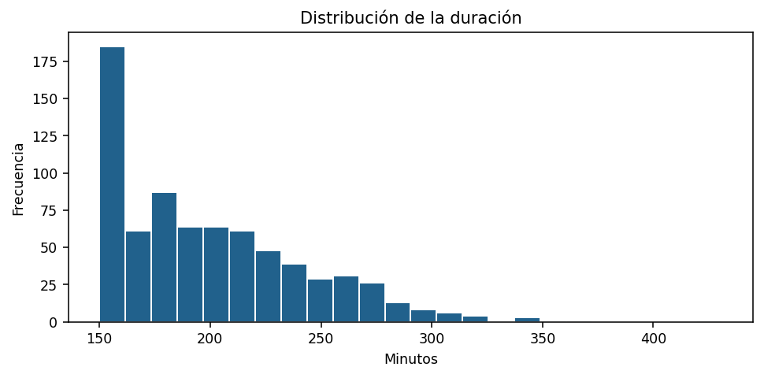
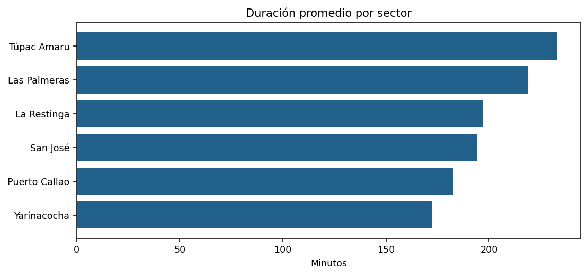
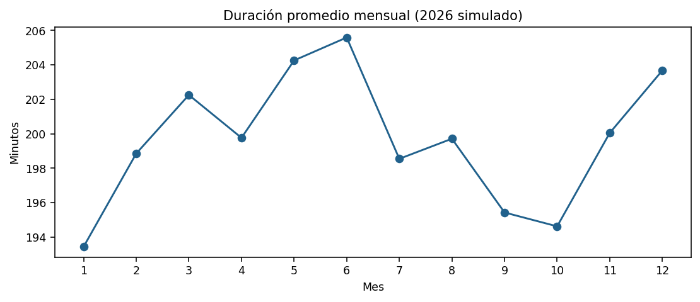
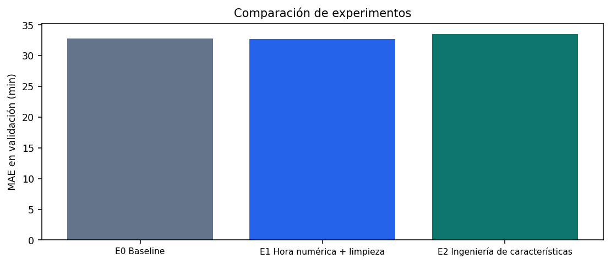

<div align="center">


**UNIVERSIDAD NACIONAL DE INGENIERÍA**  
**Unidad de Posgrado — Facultad de Ingeniería Industrial y de Sistemas**  
**Escuela de Posgrado**

# Informe de experimentación con datos
### EDA · Feature Engineering · Baseline y dos variantes

**Sistema híbrido de aprendizaje automático y optimización para mejorar la eficiencia de las rutas de recolección de residuos sólidos en el distrito de Yarinacocha, 2026**

**Autores:** Grimaldo René Abarca Urbano y Jorge Raúl Valega Marquina  
**Lima, Perú — 2026**

</div>

> **Nota metodológica:** el conjunto de datos consta de **registros simulados**. Los resultados son de carácter académico y no representan operaciones verificadas de la Municipalidad Distrital de Yarinacocha.

## 1. Resumen

Se realizó un análisis experimental sobre **733 observaciones simuladas** de rutas de recolección de residuos sólidos del distrito de Yarinacocha. Se estudió la predicción de la duración de cada ruta (minutos) mediante **Random Forest Regressor**. Se compararon un **Baseline (E0)** y **dos variantes (E1 y E2)** centradas en el tratamiento y la representación de los datos; se mantuvieron constantes los hiperparámetros del algoritmo y se reservó un período posterior para prueba final. Los resultados describen únicamente el escenario simulado, sin pretender medir el funcionamiento real de la municipalidad.

## 2. Objetivo y diseño experimental

**Objetivo:** determinar si la depuración, la codificación temporal y las características derivadas mejoran el error de predicción del tiempo de una ruta respecto del modelo de referencia.

- **Unidad de análisis:** registro de recorrido simulado.
- **Variable respuesta:** `duracion_min`.
- **Momento previsto de predicción:** antes de empezar el recorrido.
- **Modelo:** `RandomForestRegressor`.

Se excluyeron como predictores variables observadas tras la ruta: `hora_llegada`, `combustible_l`, `costo_operativo_soles`, `residuos_recolectados_kg`, `puntos_atendidos`, `cumplimiento_pct` e `incidencia`. También se omitió `distancia_km`, porque no se documentó que correspondiera a una distancia planificada conocida antes de la salida. Las coordenadas se reservaron para futuros estudios de ubicación y optimización.

## 3. Conjunto de datos y EDA

**Archivo de origen:** `residuos_yarinacocha_2026(1).csv` (en el repositorio puede estar almacenado como [`residuos_yarinacocha_2026.csv`](../residuos_yarinacocha_2026.csv)).

| Característica | Resultado |
|---|---:|
| Observaciones | 733 |
| Columnas | 18 |
| Período simulado | 01/01/2026–31/12/2026 |
| Duplicados exactos | 3 |
| Duración media | 199.70 min |
| Mediana | 191.00 min |
| Mínimo | 150 min |
| Máximo | 431 min |

Los registros posteriores a octubre de 2026 pertenecen a la simulación y no constituyen operaciones verificadas.

### 3.1. Valores faltantes

| Variable | Valores faltantes |
|---|---:|
| `combustible_l` | 6 |
| `costo_operativo_soles` | 4 |
| `latitud` | 3 |
| `longitud` | 3 |



*Figura 1. Conteo de celdas sin información en los datos originales.*

### 3.2. Distribución de las duraciones



*Figura 2. Distribución de duraciones de rutas simuladas.*

### 3.3. Duración por sector



*Figura 3. Promedio de duración por sector.*

### 3.4. Duración por mes



*Figura 4. Promedio de duración por mes.*

**Interpretación:** las duraciones muestran heterogeneidad entre sectores y meses. Estas asociaciones descriptivas no prueban causalidad. Hay faltantes en variables de resultado operativo o geolocalización que no son predictoras del experimento. Los tres duplicados exactos solo se retiran del entrenamiento en E1 y E2; validación y prueba permanecen intactas.

## 4. Feature Engineering

| Experimento | Tratamiento o característica | Justificación |
|---|---|---|
| **E0 — Baseline** | `hora_salida` como categoría y variables originales | Referencia inicial sin nuevas características |
| **E1 — Variante 1** | Eliminar duplicados del entrenamiento; crear `hora_salida_min` | Representar el horario como magnitud continua (0–1439 minutos) |
| **E2 — Variante 2** | `mes`, `dia_semana`, `fin_semana` | Captar posibles variaciones temporales |
| **E2 — Variante 2** | `puntos_por_ton_cap` | Relacionar carga programada con capacidad nominal |
| **E2 — Variante 2** | `hora_sin`, `hora_cos` | Codificación cíclica de la hora |

E1 y E2 conservan las características relativas a la ruta, el vehículo, el sector y la carga programada. Las categorías se codifican mediante **One-Hot Encoding** y se imputan por moda; las numéricas se imputan por mediana. El `Pipeline` se ajusta exclusivamente con entrenamiento. Las características derivadas no utilizan la duración final.

## 5. Partición y entrenamiento

Los registros se ordenaron por fecha y se dividieron sin mezclar fechas entre particiones:

| Partición | Registros | Proporción aproximada |
|---|---:|---:|
| Entrenamiento | 513 | 70 % |
| Validación | 110 | 15 % |
| Prueba | 110 | 15 % |

**Configuración constante de Random Forest:**

```python
RandomForestRegressor(
    n_estimators=200,
    max_depth=12,
    min_samples_leaf=3,
    random_state=42,
    n_jobs=-1
)
```

La selección se realizó por **menor MAE en validación**. El modelo elegido se reentrenó con entrenamiento y validación y se evaluó una sola vez sobre prueba. Los registros de una misma fecha permanecieron en la misma partición.

## 6. Resultados de los experimentos

| Experimento | Filas de entrenamiento | MAE (min) ↓ | RMSE (min) ↓ | R² ↑ |
|---|---:|---:|---:|---:|
| **E0 — Baseline** | 513 | 32.818 | 43.457 | 0.0438 |
| **E1 — Horario numérico y depuración** | 510 | **32.695** | 43.307 | 0.0504 |
| **E2 — Ingeniería de características** | 510 | 33.545 | **42.869** | **0.0695** |



*Figura 5. MAE sobre el mismo conjunto de validación.*

**Selección:** E1 consiguió el menor MAE en validación. Una vez seleccionada, se reentrenó y evaluó en prueba con los siguientes resultados:

| Métrica | Resultado en prueba |
|---|---:|
| MAE | **31.117 min** |
| RMSE | **38.331 min** |
| R² | **0.1102** |

El R² cercano a cero expresa una capacidad predictiva limitada frente a un predictor de referencia basado en la media del conjunto evaluado.

## 7. Discusión y limitaciones

Los experimentos modificaron únicamente la representación o depuración de los datos, manteniendo constante el algoritmo y sus hiperparámetros. Las diferencias de validación reflejan estas decisiones dentro del conjunto simulado, pero no necesariamente se generalizan. E1 y E2 también reducen el número de observaciones de entrenamiento al retirar duplicados, aspecto que debe considerarse al interpretar el efecto de las transformaciones.

**Limitaciones:** simulación de datos; falta de validación externa; una sola división temporal; posible dependencia entre rutas repetidas; escasa trazabilidad del proceso de generación de los datos. Los resultados **no acreditan mejoras reales** del servicio municipal y todavía **no evalúan la optimización de rutas**. Crear nuevas características no garantiza una mejora: también puede añadir ruido o redundancia.

## 8. Conclusiones

1. El EDA identificó **3 registros duplicados**, valores faltantes localizados y variación de duración entre sectores y meses.
2. Se construyeron tres representaciones de los datos para predecir la duración a partir de información disponible antes del recorrido.
3. E1 obtuvo el menor MAE en validación y fue la configuración seleccionada. Su evaluación final corresponde exclusivamente a los datos simulados.
4. Se recomienda validar con registros reales, documentar el momento en que se dispone de cada predictor y posteriormente integrar la predicción con la optimización de rutas.

## 9. Reproducibilidad y archivos

- **Notebook:** `Experimentos_Yarinacocha_Colab.ipynb` (subirlo a esta misma carpeta).
- **Datos:** [`residuos_yarinacocha_2026.csv`](../residuos_yarinacocha_2026.csv) (actualmente en la raíz del repositorio).
- **Gráficos:** carpeta `imagenes/`, extraída directamente del informe Word.
- **Resultados estructurados:** `resultados_experimentos.json` (incluirlo si se genera con el notebook).

> Para reproducir los cálculos, ejecutar el notebook en Google Colab y verificar que el archivo CSV esté disponible en la ruta indicada por las celdas de carga de datos.
